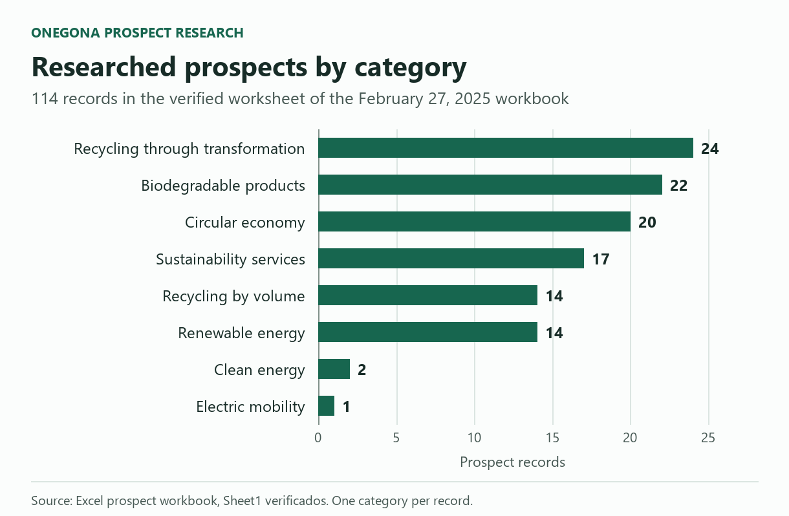
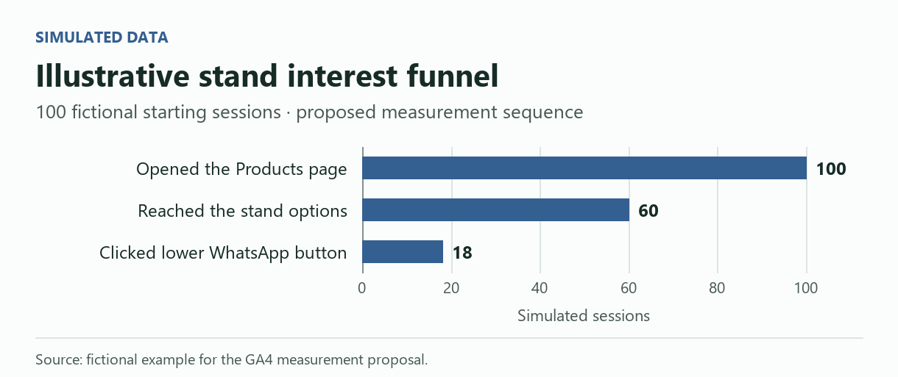

# Feria Sostenible | Exhibitor Research and Marketing Analytics

## Project Overview

During my advertising and marketing internship at Onegona, I researched prospective exhibitors and strategic partners for Feria SOStenible and organized the records in Excel. This case shows how the research could inform outreach priorities and includes a separate, simulated example of how the fair could measure interest in exhibition stands.

## Business Context

Feria SOStenible brought sustainable products and responsible consumption initiatives to a public audience in Panama City. The commercial challenge was to identify relevant organizations for the fair and give the team a way to decide which prospects to review first. [Ciudad del Saber event listing](https://ciudaddelsaber.org/eventos/feria-sostenible)

## Data Sources

| Source | Scope | Use in this case |
| --- | --- | --- |
| General prospect workbook, version dated February 24, 2025 | 99 prospect records in `Sheet1 verificados` | Earlier version used to check which records carried forward. |
| Prospect workbook, version dated February 27, 2025 | 114 prospect records in `Sheet1 verificados`, rows 2–115 | Source for the chart. The 18 rows in `Sheet2 sin verificar` are outside this count. |

The campaign report and presentation provide context on the fair’s positioning and promotion plans. The workbook supplies the prospect records used in the analysis.

## Objectives

- Organize the research on potential exhibitors and strategic partners by area of activity.
- Describe which sustainability categories had the most research coverage and where additional prospect research could broaden the list.

## Analytical Workflow

### Exhibitor Prospect Research and Segmentation

#### Research

At Onegona, I manually reviewed sustainability-related profiles to identify organizations that could be considered for exhibitor or partner outreach.

#### Data Preparation and Classification

I recorded prospect information in Excel and grouped prospects by area of activity. For this case study, duplicate checks used normalized names and Instagram profile fields. Case, spelling, and accent variants in category labels were combined. Clean energy and renewable energy were kept separate because the workbook labels them separately.

#### Descriptive Analysis

The analysis counts one prospect record per populated row in `Sheet1 verificados`, with one category per record. The two workbook versions were compared using the normalized profile field. All 99 earlier records carried forward and the later version added 15.

#### Visualization

The horizontal bar chart compares the number of records across the eight sustainability categories in the later workbook.

## Findings

Recycling through transformation (24), biodegradable products (22), and circular economy (20) accounted for **66 of 114 researched prospect records**. Clean energy (2) and electric mobility (1) had the fewest records in the workbook.

## Recommendations

- Use the three categories with the most records as starting points for reviewing potential exhibitors and partners for outreach.
- If broader coverage is a goal, research additional organizations in clean energy and electric mobility before drawing conclusions about those categories.

## Limitations

- **Researched prospects** are records in the workbook. The word *verified* refers to the worksheet name used in this analysis.
- **Potential exhibitors** are prospects considered for exhibitor outreach. The workbook also covers potential strategic partners, and the analysis does not establish a separate exhibitor count.
- **Confirmed attendees** require separate participation records. The campaign materials report participation confirmations, but the prospect workbook cannot confirm those claims or show who actually attended.
- The category counts describe research coverage. The workbook does not establish market demand or outreach outcomes, and the available files do not document a consistent scoring rule for the relevance field.

## Simulated Portfolio Extension | Measuring Exhibitor Interest

**Business question** — Among sessions that reach the Products page, what share reach the stand options and then click the lower WhatsApp button?

### Proposed Measurement Plan

The public Products page lists stand options and offers a lower **Escríbenos** button as well as a separate WhatsApp shortcut near the top. The proposed sequence follows the path through the stand options to the lower button. [Feria SOStenible Products page](https://feriasostenible.com/productos/)

| Step | Proposed event | When to record it |
| --- | --- | --- |
| Open the Products page | `products_view` | The Products page loads. |
| Reach the stand options | `stand_options_view` | The stand-options section becomes visible. |
| Click the lower WhatsApp button | `exhibitor_whatsapp_click` | The visitor clicks the lower **Escríbenos** button. |

In a possible GA4 implementation, count each step once per session and require the steps to occur in order. Validate the visibility and click events on mobile and desktop, and distinguish the lower button from the top shortcut. The final event would measure a click. Messages, qualified leads, and bookings would require separate evidence.

### Simulated Funnel Example

The example uses **simulated data** throughout. Of 100 fictional sessions, 60 reach the stand options and 18 click the lower button. That gives step-to-step rates of **60%** and **30%**, and an overall click rate of **18%**. If verified event data showed a similar pattern, I would compare the journey by device before testing whether moving the button closer to the stand options helped. GA4 implementation and observed funnel performance remain future work.
